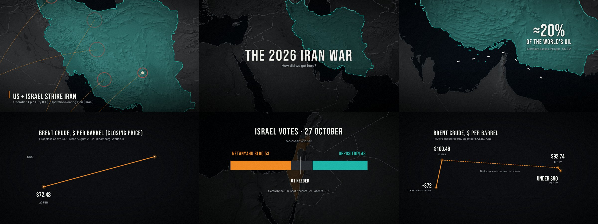
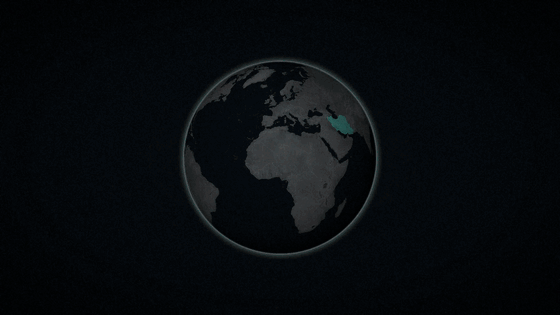

# map-documentary-maker

**Make map-animated documentary explainers with Claude Code, on your own computer, for $0.**

You give a topic. Claude researches it with sources, has a second agent fact-check it, writes the script, narrates it with a free AI voice, times every word, finds real free-licence photos, animates dark relief maps with moving jets and ships, renders the video, and writes the thumbnail, title and description. You approve each step.

A Claude Code skill from the [Think with MR](https://www.youtube.com/@ThinkwithMRG) YouTube channel. It made [The Iran War Explained (2026)](https://youtu.be/TUuvIw6EoIs), a 6-minute documentary on Think with MG.



<p align="center"><br><sub>The 26-second demo in <code>examples/demo</code>: globe dive, real Navy footage, kinetic text on the voice, live tanker traffic, a source clipping (<a href="docs/demo.mp4">MP4 with sound</a>)</sub></p>

## The tools behind it (all free)

| Step | Tool | Runs |
|---|---|---|
| Research + fact-check | Claude Code web search + an independent fact-check subagent | Claude |
| Script | Claude, sized at ~150 words per minute, split into 90-second parts | Claude |
| Voice | [Kokoro-82M](https://huggingface.co/hexgrad/Kokoro-82M) text-to-speech (Apache 2.0), or your own recording | your computer |
| Word timing + script check | [faster-whisper](https://github.com/SYSTRAN/faster-whisper) `large-v3-turbo` | your computer |
| Maps | [Natural Earth](https://www.naturalearthdata.com/) borders + shaded relief (public domain) | your computer |
| Photos and footage | [Wikimedia Commons](https://commons.wikimedia.org/), reuse licences only, credits kept | download |
| Animation | Python (numpy, OpenCV, Pillow) + ffmpeg, 1080p 30 fps | your computer |
| Fonts | Bebas Neue, Inter, Source Serif 4 (Open Font License) | your computer |

No paid API, no stock subscription, no video editor.

## What the videos look like

- An opening globe that spins and dives into the story's region
- Dark shaded-relief maps with a slow camera; the story's countries glow in one accent colour each
- Kinetic text: key lines typed on screen word by word, exactly when the narrator says each word
- Ships and planes moving continuously along lanes, with wakes
- Dashed routes that draw on, with jets, ships, carriers, drones and missiles riding them; strike flashes
- Big date cards that type on, lower thirds, counters, chapter cards
- Real news sentences on paper clippings with a yellow highlight that draws on
- Charts that plot **only sourced data points**, with gaps dashed and labelled
- Real, credited photos (portrait layout for people) and footage (cropped and graded to match the maps)
- Soft whooshes on cuts, loudness-normalised narration, no music unless you ask

## How it works

| Stage | What happens | You |
|---|---|---|
| 1. Brief | topic, length, voice, 16:9 or 9:16 | answer once |
| 2. Research | timeline, conflicting figures, exact quotes, coordinates, 2 sources per fact; a separate agent checks it | |
| 3. Script | beats with narration, visual and sources | approve |
| 4. Voice | Kokoro narrates each part; Whisper checks every word against the script and times it | |
| 5. Scene plan | a shot every 3-6 s, timed to the voice; real photos found on Commons | approve |
| 6. Animation | each part rendered, then checked on contact sheets (a still every 2 s) for overlaps | approve each part |
| 7. Package | thumbnail (tested at phone size), title, description with chapters, sources and credits | approve |

Nothing is uploaded or posted unless you say so. Every render gets a new version number; nothing is overwritten.

## Install

**Requirements:** [Claude Code](https://claude.com/claude-code) · ffmpeg (`brew install ffmpeg` on macOS, `winget install ffmpeg` on Windows, `sudo apt install ffmpeg` on Linux) · about 3 GB of disk for the voice and speech models and map data. Python is installed for you (via uv).

In Claude Code:
```
/plugin marketplace add mrgoraya/map-documentary-maker
/plugin install map-documentary-maker@map-documentary-maker
```

Or copy `skills/map-documentary-maker` into `~/.claude/skills/` (all projects) or `.claude/skills/` (one project).

Then just ask: **"start a documentary video about the Suez Crisis, 5 minutes"**. On first use Claude runs `scripts/setup.sh` (5-15 minutes, once).

## Try the demo

```bash
cd examples/demo
PY=~/.cache/map-documentary-maker/venv/bin/python; SK=../../skills/map-documentary-maker/scripts
bash $SK/setup.sh            # once
$PY $SK/fetch_commons.py get "File:Oil tanker Niovi seized by Iran's Islamic Revolutionary Guard Corps Navy.webm" v_niovi
$PY $SK/prep_geo.py          # map data for this project's area + the globe
$PY $SK/narrate.py all       # Kokoro voice -> voice/part1_v01.wav
$PY $SK/align.py all         # word timings + script check -> sentences.json
$PY $SK/render.py part 1     # -> out/part1_v01.mp4
```

`examples/iran-war-2026` has everything behind the real 6-minute film: research brief (93 sources and the fact-check log), script, scene plan, the actual `scenes.py`, the upload pack, and `fetch_assets.sh` to re-download its Commons photos.

## Repository layout

```
skills/map-documentary-maker/
  SKILL.md                 the stages Claude follows
  references/              style guide, kit API, narration, research, licences, QA checklist, templates
  scripts/                 setup.sh, new_project.py, prep_geo.py, narrate.py, align.py,
                           fetch_commons.py, render.py, docukit/ (the animation kit)
  templates/               starter scenes.py, thumbnail.py, YOUTUBE.md
examples/demo              26-second demo using every shot type (EIA facts about the Strait of Hormuz)
examples/iran-war-2026     the full real project
```

## The honesty rules built in

- Two independent sources per fact, or the narration says who claims it
- An independent agent re-checks every number, date, name and quote against the pages
- On-screen clippings are word-for-word quotes with outlet and date
- No invented chart values, no maps that imply regional splits that aren't there
- No AI-generated images of real people; every photo is real and credited
- The description discloses the AI voice and lists the sources

## Credits

Map data: Natural Earth. Voice: Kokoro-82M by hexgrad. Speech recognition: faster-whisper (OpenAI Whisper weights). Fonts: Bebas Neue (Dharma Type), Inter (Rasmus Andersson), Source Serif 4 (Adobe), all OFL. Media: Wikimedia Commons contributors (credited per file).

## License

MIT, see [LICENSE](LICENSE). Videos you make are yours; keep the photo credits and licences of the media you use.
